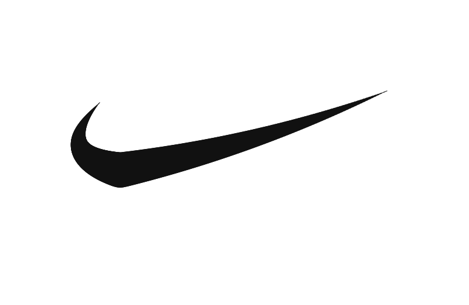

# XIFF

XIFF is a tiny intent-geometry language for drawing with math instead of raw
SVG path commands. It renders directly to PNG and has no runtime dependencies.


One robot definition, placed three times at two scales.
[Read the drawing](examples/robot_garden.xiff) or [try it below](#quick-start).

The core idea: every stroke starts in a local x-axis coordinate system. XIFF
directives describe intent like length, bend position, bend amount, mirror,
repeat, and placement. The engine resolves that intent into geometry, then
rasterizes it.

```xiff
canvas 220 120
palette #ffffff #111111 #e94560

line x=20 y=88 length=160 width=2 color=2
curve x=20 y=88 length=160 bend_at=50 bend=-42 width=7 color=1
```

## Why XIFF

SVG is powerful, but its path syntax is low-level. XIFF is meant to be easier
for humans and language models to compose:

```xiff
curve x=360 y=210 length=188 bend_at=58 bend=-86 angle=-18 width=8 color=2
mirror axis=y pivot=360
repeat count=8 dangle=45
```

That says what the shape should do. The engine handles the coordinates.

## Status

This is an experimental alpha. Syntax and behavior may change as we learn
from real drawings:

- dependency-free Python 3.10+
- direct PNG writer
- command-line renderer
- reusable groups
- mirror/repeat/place preprocessing
- core primitives: `line`, `curve`, `wave`, `arc`, `circle`, `rect`
- test suite and CI config

## Quick start

Python 3.10 or newer is required. No package installation is needed to try it:

```bash
git clone https://github.com/jugert-mucoimaj/xiff.git
cd xiff
python3 engine.py examples/robot_garden.xiff robot_garden.png
```

Open `robot_garden.png` to see the result. Edit the `.xiff` source and run
the command again to redraw it.

## Install

From the repository root:

```bash
python3 -m venv .venv
. .venv/bin/activate
python -m pip install -e .
```

Then render any `.xiff` file:

```bash
xiff examples/freeform_orbit.xiff freeform_orbit.png
```

You can also run the engine directly:

```bash
python3 engine.py examples/bend.xiff bend.png
```

## Examples

| Drawing | Source | What it exercises |
| --- | --- | --- |
| Robot Garden | [robot_garden.xiff](examples/robot_garden.xiff) | Groups, scaling, mirrors, curves, repetition |
| Letter A | [letter_a.xiff](examples/letter_a.xiff) | Lines and reflection |
| Orbit Bloom | [freeform_orbit.xiff](examples/freeform_orbit.xiff) | Arcs, waves, and repeated curves |
| Google G study | [google_g.xiff](examples/logo_tests/google_g.xiff) | Color bands and a crossbar |
| Swoosh study | [nike_swoosh.xiff](examples/logo_tests/nike_swoosh.xiff) | A tapered silhouette expanded into short lines |

The logo studies are approximations, not official assets. They deliberately
expose current limitations: the G uses narrow concentric arcs for flat color
joins, and the swoosh uses many short lines for varying width. The
[study builder](examples/logo_tests/build.py) generates both sources using
the existing engine. They are experiments, not examples of concise syntax.

<details>
<summary>View the two logo studies</summary>




</details>

```bash
xiff examples/bend.xiff bend.png
xiff examples/letter_a.xiff letter_a.png
xiff examples/groups.xiff groups.png
xiff examples/freeform_orbit.xiff freeform_orbit.png
xiff examples/netflix_logo.xiff netflix_logo.png
xiff examples/facebook_logo.xiff facebook_logo.png
```

## Language

### Document

```xiff
canvas 720 420
palette #0b1020 #f7f3e8 #ff4d6d #4cc9f0
```

`palette` index `0` is the background color. Other directives use
`color=N`.

### Lines

```xiff
line x=20 y=88 length=160 angle=0 width=7 color=1
```

The line starts at `(x, y)`, grows along its local x-axis by `length`, then
rotates by `angle` degrees.

### Quadratic Curves

```xiff
curve x=20 y=88 length=160 bend_at=50 bend=-42 width=7 color=1
```

The engine solves a quadratic through:

- `(0, 0)`
- `(length, 0)`
- `(bend_at, bend)`

Then it transforms the curve into canvas space.

### Waves

```xiff
wave x=20 y=40 length=120 amp=12 cycles=2 width=4 color=2
```

Waves use sine over the local x-axis.

### Arcs

```xiff
arc x=110 y=90 r=42 start=25 end=330 width=10 color=1
```

Angles are degrees. Coordinates start at the top-left: x increases rightward
and y increases downward, so positive angles turn clockwise. An arc goes
from `start` to `end` numerically; use `end=385` to go forward from 300
through zero to 25 degrees.

### Circles And Rectangles

```xiff
circle x=80 y=80 r=32 color=1
circle x=80 y=80 r=32 fill=0 width=8 color=2
rect x=40 y=120 w=90 h=20 angle=-8 color=3
```

`circle fill=0` draws a stroked circle. `rect` supports rotation.

### Mirror

`mirror` duplicates the previous drawable and reflects it across an axis:

```xiff
line x=58 y=174 length=138 angle=-72 width=12 color=1
mirror axis=y pivot=100
```

`axis=y pivot=100` mirrors across the vertical line `x=100`.
`axis=x pivot=80` mirrors across the horizontal line `y=80`.

### Repeat

`repeat` duplicates the previous drawable. `count` includes the original:

```xiff
wave x=20 y=40 length=80 amp=8 cycles=1 width=3 color=3
repeat count=4 dx=48
```

Supported repeat modifiers:

- `dx`, `dy`
- `dangle` or `angle_step`
- `dbend`
- `dwidth`
- `color`

### Groups And Place

Groups store reusable directives. `place` expands a group with translation,
scale, and rotation:

```xiff
group name=A
  line x=58 y=174 length=138 angle=-72 width=12 color=1
  mirror axis=y pivot=100
  line x=78 y=116 length=44 angle=0 width=9 color=2
end

place name=A x=0 y=0 scale=1
place name=A x=120 y=35 scale=0.55 angle=12
```

Groups are preprocessed, so `mirror` and `repeat` work inside them.
Placement scales dimensions and stroke widths as well as positions.
`mirror` and `repeat` operate on the last individual drawable, including
after a group placement; they do not duplicate the entire group.

## Python API

```python
import xiff

xiff.render_file("examples/bend.xiff", "bend.png")
xiff.render_text_to_png("""
canvas 64 64
palette #fff #111
circle x=32 y=32 r=16 color=1
""", "circle.png")
```

## Development

Run tests:

```bash
python3 -m unittest discover -s tests
```

Compile check:

```bash
python3 -m py_compile engine.py
```

The project intentionally avoids external runtime dependencies. Keep the
engine small, readable, and math-first.

## Contributing

Draw something with XIFF and show us what was easy or difficult. Small
examples, unexpected output, and clear bug reports are especially useful.
See [CONTRIBUTING.md](CONTRIBUTING.md) for setup, checks, and design principles.

## Current limitations

- Output is PNG only, with an opaque background.
- Strokes have constant width and round segment ends; tapering and flat
  caps are not native language features yet.
- Curves use fixed sampling, so extreme sizes or bends can reveal artifacts.
- `bend_at` is a point the quadratic passes through, not a movable apex.
  The quadratic's apex remains halfway along its local x-axis.
- Validation is incomplete. Large canvases or off-canvas shapes can consume
  substantial time and memory; there are no rendering resource limits.
- Groups cannot be nested. A group referenced inside another must already
  have been defined.

## Roadmap

- `quad` filled primitive for exact slanted blocks
- native tapered strokes
- flat caps and more consistent joins
- anchors such as `anchor=center`
- reusable glyph helpers
- better logo/glyph recipes
- optional higher-resolution supersampling

## License

MIT. See [LICENSE](LICENSE).
